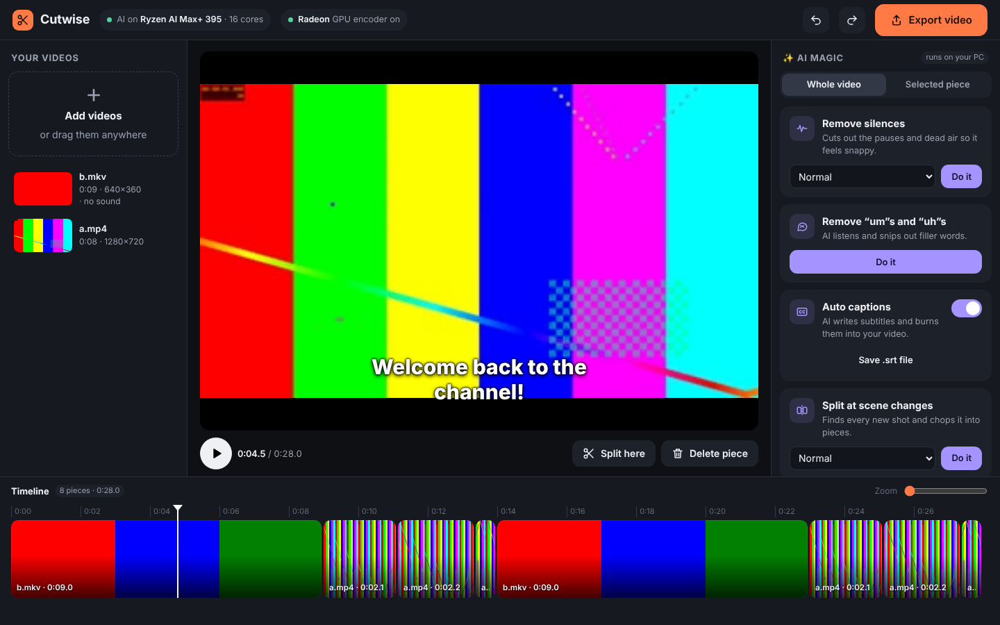

# Cutwise — the easy AI video editor

Everything runs on your own PC. Nothing is uploaded anywhere.

## Start it
Double-click **Start Cutwise.bat**. The first time, it installs what it needs (FFmpeg, Python bits) — give it a minute or two. Then your browser opens to the editor.
Keep the black window open while you edit; close it when you're done.

## How to use it
1. **Add videos** — click *Add videos* or drag them onto the window.
2. **AI magic** (right side) — choose *Whole video* or *Selected piece*, then:
   - **Remove silences** — cuts pauses and dead air.
   - **Remove "um"s and "uh"s** — AI listens and snips filler words.
   - **Auto captions** — AI writes subtitles; they show in the preview and get burned into the export. *Save .srt* gives you a caption file for YouTube.
   - **Split at scene changes** — chops a long video into its shots.
   - **Auto-enhance** — richer color and cleaner, evened-out sound on export.
3. **Edit** — click a piece to select it, drag its orange edges to trim, drag pieces to reorder, *Split here* (S) to cut at the white line, *Delete piece* (Del) to remove. **Ctrl+Z undoes anything**, including AI edits.
4. **Export video** — pick size and quality. Finished videos go to `%USERPROFILE%\Cutwise\exports` (your user folder → Cutwise → exports); *Show in folder* takes you there.

## How it uses your Ryzen AI Max+ 395
- **Speech AI** (captions, filler words) runs OpenAI Whisper via faster-whisper on your **16 Zen 5 CPU cores**. *Best* uses the large-v3-turbo model; *Fast* uses small. The model downloads once (to `Cutwise\models`).
- **Exports and previews** use the **Radeon 8060S GPU's video encoder** (AMF) — the chip shows "Radeon GPU encoder on" when it's working. If it isn't available, Cutwise falls back to the CPU automatically.
- Silence and scene detection run through FFmpeg on all CPU threads.
- The NPU isn't used: Whisper on the Ryzen NPU still needs AMD's separate Ryzen AI software stack, and on this chip the CPU cores are faster for it anyway.

## Files
- Your projects autosave. Videos you add with the *Add videos* button are used in place (never copied); dragged-in videos are copied to `Cutwise\media`.
- Data folder: `%USERPROFILE%\Cutwise` (set `CUTWISE_HOME` to move it).
